# Jarkom-Modul-3-2026-K-62

| Nama | NRP |
| :--- | :---: |
| Daffa Ulhaq Fadhlurrahman | 5027251033 |
| Michiko Artika Satriyo | 5027251105 |

## Soal 1.
Ketika Curtain menutup Shibuya, jalur komunikasi antar zona Jujutsu High terputus. Pulihkan konektivitas dasar dengan mengonfigurasi jichi: eth0 memperoleh WAN dari NAT, sedangkan eth1–eth4 menjadi gateway Network 1–4 sesuai tabel pemetaan. Aktifkan IPv4 forwarding dan source NAT, lalu tetapkan IP statis host infrastruktur sesuai tabel spesifikasi. Buktikan konektivitas setiap host ke gateway dan akses eksternal dari host yang relevan.

### Testing
- `ping -c 2 8.8.8.8`
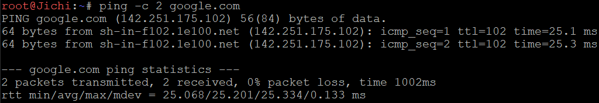

- testing pada `jichi` dan `8.8.8.8`
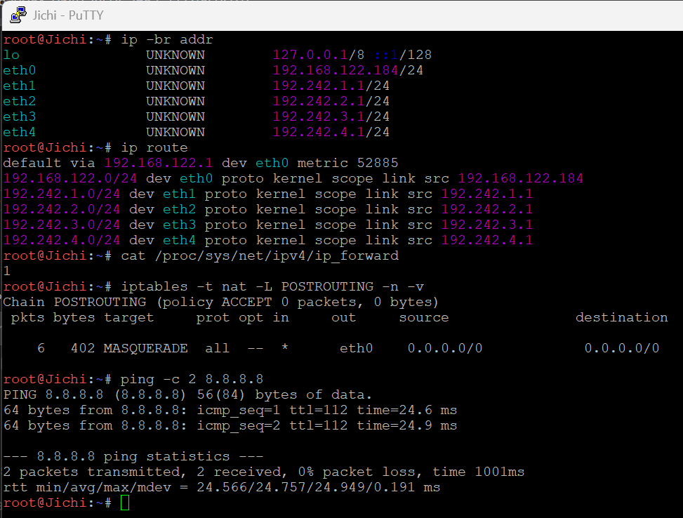

- testing node ke router
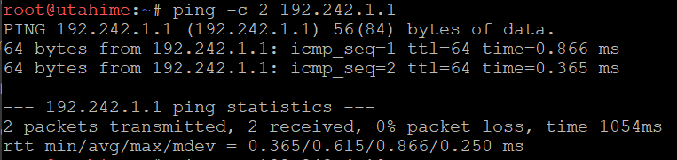

- testing antar nodes beda switch
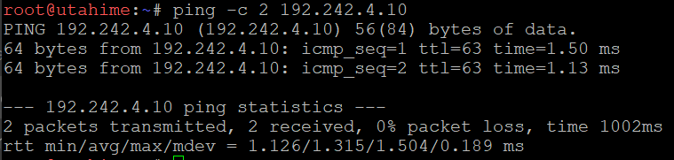
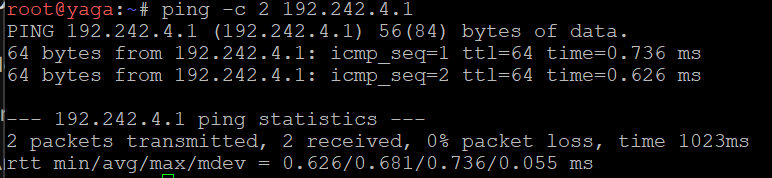

## Soal 2.
Tengen, penjaga pusat distribusi di Data Center, harus mengambil alih pengalokasian alamat bagi wilayah yang membutuhkan konfigurasi dinamis. Konfigurasikan isc-dhcp-server pada [PREFIX IP].4.10. Deklarasikan Network 4 ([PREFIX IP].4.0/24) sebagai subnet lokal tanpa pool dinamis, lalu siapkan scope DHCP untuk Network 2 ([PREFIX IP].2.0/24) dan Network 3 ([PREFIX IP].3.0/24). Validasi konfigurasi dan pastikan service aktif tanpa error “No subnet declaration”.

### Testing
- validasi konfigurasi `tengen`
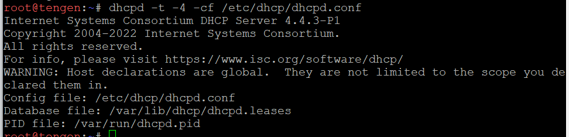

- cek service aktif
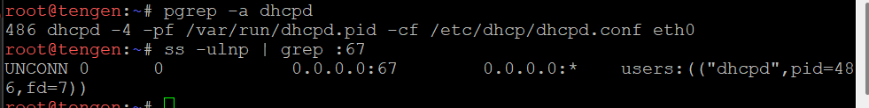

- memastikan tanpa error
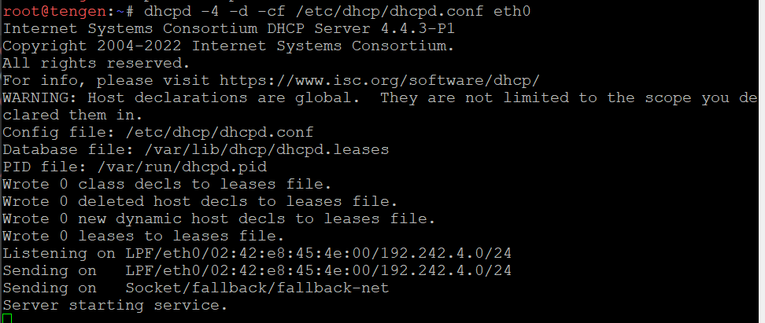
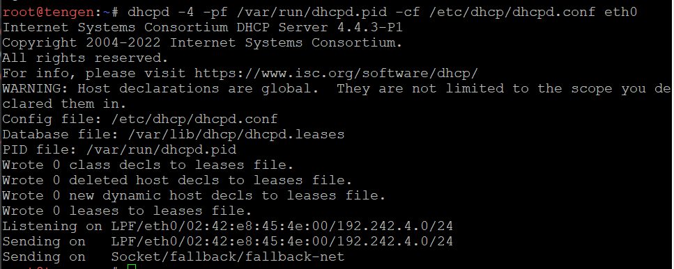

## Soal 3.
Permintaan alamat dari Divisi A dan Divisi B tidak dapat menyeberangi subnet secara langsung. Konfigurasikan jichi sebagai DHCP Relay menuju tengen ([PREFIX IP].4.10), menggunakan eth2 untuk Network 2 dan eth3 untuk Network 3. Buktikan bahwa client dari kedua subnet berhasil memperoleh lease melalui relay.

### Pengerjaan
Menjalankan relay di `jichi`:
`pkill dhcrelay`
`/usr/sbin/dhcrelay -i eth2 -i eth3 -i eth4 192.242.4.10`
`pgrep -a dhcrelay`

Memastikan `tengen` aktif (menggunakan command `pgrep -a dhcpd`)

### Testing
- `itadori`:
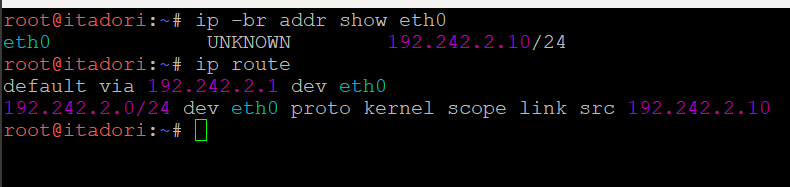

- `tengen`cek entri leases dengan `cat /var/lib/dhcp/dhcpd.leases`

## Soal 7.
Setelah aturan alokasi diterapkan, pastikan setiap client menerima konfigurasi jaringan sesuai wilayahnya: subnet mask 255.255.255.0 (/24), gateway dan broadcast address yang benar, DNS [PREFIX IP].1.2 serta [PREFIX IP].1.3, dan domain-search yang ditentukan. Periksa IP address dan routing seluruh client Divisi A dan Divisi B, kemudian cocokkan lease dengan /var/lib/dhcp/dhcpd.leases pada tengen. Pastikan tidak ada alamat yang bertabrakan atau berada di luar kebijakan pool.

### Pengerjaan
Seluruh nilai yang diterima client berasal dari `/etc/dhcp/dhcpd.conf` di `tengen` (soal 2 sampai soal 6):
| Nilai | Sumber di `dhcpd.conf` |
| :--- | :--- |
| DNS `192.242.1.2`, `192.242.1.3` | `option domain-name-servers` (global) |
| Domain-search `K62.com` | `option domain-search` (global) |
| Subnet mask, gateway, broadcast | `option subnet-mask`, `option routers`, `option broadcast-address` pada tiap blok `subnet` |

### Testing
- Tampilkan IP, mask, broadcast, gateway, DNS, domain-search, dan optiondari server untuk setiap node di switch 5, 6, 7, dan 8:
```bash
ip -4 addr show eth0
ip route
cat /etc/resolv.conf
grep -E 'fixed-address|subnet-mask|routers|broadcast-address|domain-name-servers|domain-search' /var/lib/dhcp/dhclient*.leases
```
| Client | MAC | IP/Mask | Gateway | Broadcast | DNS | Domain-search |
| :--- | :--- | :--- | :--- | :--- | :--- | :--- |
| itadori | `de:ad:be:ef:62:02` | `192.242.2.10/24` | `192.242.2.1` | `192.242.2.255` | `192.242.1.2`, `192.242.1.3` | `K62.com.` |
| fushiguro | `de:ad:be:ef:62:03` | `192.242.2.11/24` | `192.242.2.1` | `192.242.2.255` | `192.242.1.2`, `192.242.1.3` | `K62.com.` |
| zenin | `de:ad:be:ef:62:04` | `192.242.2.70/24` | `192.242.2.1` | `192.242.2.255` | `192.242.1.2`, `192.242.1.3` | `K62.com.` |
| okkotsu | `de:ad:be:ef:62:05` | `192.242.2.71/24` | `192.242.2.1` | `192.242.2.255` | `192.242.1.2`, `192.242.1.3` | `K62.com.` |
| ino | `de:ad:be:ef:62:06` | `192.242.3.10/24` | `192.242.3.1` | `192.242.3.255` | `192.242.1.2`, `192.242.1.3` | `K62.com.` |
| kusakabe | `de:ad:be:ef:62:07` | `192.242.3.11/24` | `192.242.3.1` | `192.242.3.255` | `192.242.1.2`, `192.242.1.3` | `K62.com.` |
| miwa | `de:ad:be:ef:62:08` | `192.242.3.100/24` | `192.242.3.1` | `192.242.3.255` | `192.242.1.2`, `192.242.1.3` | `K62.com.` |
| kugisaki | `de:ad:be:ef:62:01` | `192.242.3.99/24` | `192.242.3.1` | `192.242.3.255` | `192.242.1.2`, `192.242.1.3` | `K62.com.` |

- Pada `tengen`, daftar lease aktif untuk dicocokkan dengan IP di client:
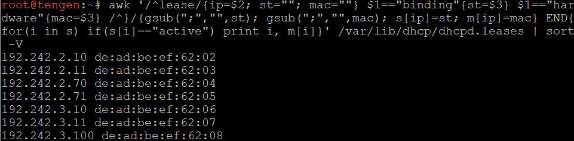

| IP | MAC | Client | Pool |
| :--- | :--- | :--- | :--- |
| `192.242.2.10` | `de:ad:be:ef:62:02` | itadori | Pool 1 (`.2.10–.2.35`) |
| `192.242.2.11` | `de:ad:be:ef:62:03` | fushiguro | Pool 1 (`.2.10–.2.35`) |
| `192.242.2.70` | `de:ad:be:ef:62:04` | zenin | Pool 2 (`.2.70–.2.95`) |
| `192.242.2.71` | `de:ad:be:ef:62:05` | okkotsu | Pool 2 (`.2.70–.2.95`) |
| `192.242.3.10` | `de:ad:be:ef:62:06` | ino | Short lease (`.3.10–.3.89`) |
| `192.242.3.11` | `de:ad:be:ef:62:07` | kusakabe | Short lease (`.3.10–.3.89`) |
| `192.242.3.100` | `de:ad:be:ef:62:08` | miwa | Long lease (`.3.100–.3.199`) |

- `kugisaki` tidak muncul di `dhcpd.leases` karena alamat `fixed-address` tidak dicatat di file tersebut. Reservasinya dibuktikan dari sisi client (IP `192.242.3.99`) dan dari konfigurasi di `tengen`:
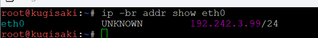
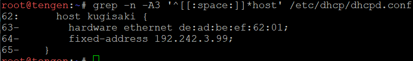

- Pada `tengen`, membuktikan tidak ada alamat di luar kebijakan pool (output harus kosong):
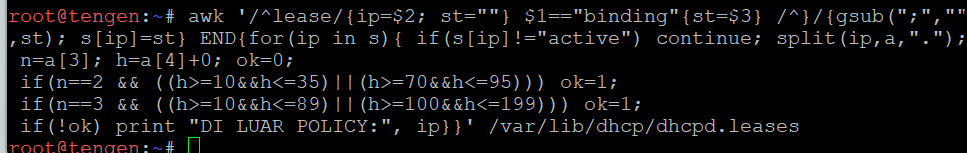

- Membuktikan tidak ada IP yang bertabrakan di antara 8 client (output harus kosong):
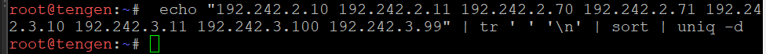

## Soal 8.
Sebelum Curtain dibuka kembali, buktikan bahwa proses pemberian alamat berjalan sesuai protokol. Lakukan packet capture saat salah satu client Network 2 atau Network 3 meminta lease baru. Gunakan tcpdump pada tengen atau jalur menuju Data Center untuk menunjukkan urutan DHCPDISCOVER → DHCPOFFER → DHCPREQUEST → DHCPACK. Identifikasi alamat server, alamat yang diberikan, lease time, dan field giaddr. Pastikan nilai giaddr sesuai dengan interface jichi yang menerima request dari subnet client.

### Testing
- Pada `itadori`, buang lease lama agar proses DORA berjalan, lalu minta lease baru:
```bash
pkill dhclient
ip addr flush dev eth0
rm -f /var/lib/dhcp/dhclient*.leases
dhclient -v eth0
```
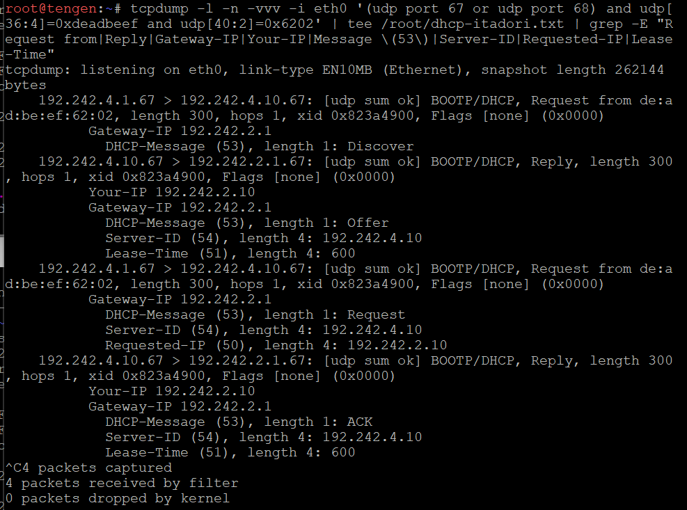

| Paket | Arah | Isi penting |
| :--- | :--- | :--- |
| DHCPDISCOVER | `192.242.4.1` → `192.242.4.10` | `Request from de:ad:be:ef:62:02`, `hops 1`, `Gateway-IP 192.242.2.1`, tanpa `Requested-IP` |
| DHCPOFFER | `192.242.4.10` → `192.242.2.1` | `Your-IP 192.242.2.10`, `Server-ID 192.242.4.10`, `Lease-Time 600` |
| DHCPREQUEST | `192.242.4.1` → `192.242.4.10` | `Requested-IP 192.242.2.10`, `Server-ID 192.242.4.10`, `Gateway-IP 192.242.2.1` |
| DHCPACK | `192.242.4.10` → `192.242.2.1` | `Your-IP 192.242.2.10`, `Server-ID 192.242.4.10`, `Lease-Time 600` |

Paket dari `jichi` ke `tengen` bersumber `192.242.4.1` (interface `eth4`, menghadap Data Center). Balasan `tengen` dikirim ke `192.242.2.1`, yaitu nilai `giaddr`, sehingga kembali ke `jichi` dan diteruskan ke client.

Identifikasi hasil capture:

| Informasi | Nilai | Sumber di capture |
| :--- | :--- | :--- |
| Alamat server | `192.242.4.10` | `Server-ID` pada Offer, Request, dan ACK |
| Alamat yang diberikan | `192.242.2.10` | `Your-IP` pada Offer dan ACK (di dalam Pool 1 `.2.10–.2.35`) |
| Lease time | `600` detik | `Lease-Time` pada Offer dan ACK (default global) |
| giaddr | `192.242.2.1` | `Gateway-IP` pada keempat paket |

- Pada `jichi`, membuktikan `giaddr` sama dengan IP interface yang menerima request dari Network 2:
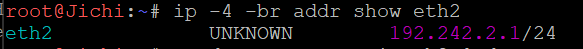

`eth2` bernilai `192.242.2.1/24`, sama dengan `Gateway-IP` pada capture. Untuk client Network 3, `giaddr` akan bernilai `192.242.3.1` (interface `eth3`).

## Soal 9.
Sebuah gangguan memutus jalur relay dan membuat permintaan alamat tidak sampai ke Data Center. Hentikan service DHCP Relay pada jichi, lalu paksa salah satu client di Network 2 atau Network 3 meminta lease baru dan catat gejalanya. Pulihkan service relay, ulangi permintaan DHCP, lalu buktikan bahwa client kembali memperoleh alamat dari pool yang benar dengan gateway semula.

### Pengerjaan
Kondisi normal sebelum gangguan pada `itadori`:
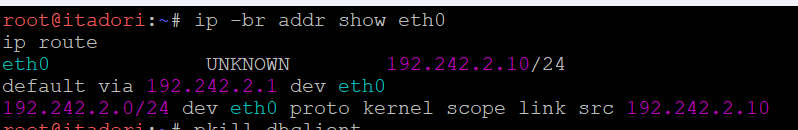

Menghentikan relay pada `jichi`:
`pkill dhcrelay`
`pgrep -a dhcrelay`

Memulihkan relay pada `jichi`:
`/usr/sbin/dhcrelay -i eth2 -i eth3 -i eth4 192.242.4.10`
`pgrep -a dhcrelay`

### Testing
Pada `itadori`, buang lease lama agar permintaan DHCP dimulai dari awal, lalu minta lease baru.
- Saat relay mati, `dhclient` hanya mengirim `DHCPDISCOVER` berulang (6 kali dengan interval membesar), lalu berakhir dengan `No DHCPOFFERS received` dan `No working leases in persistent database - sleeping`. `eth0` tidak memiliki IPv4 dan `ip route` kosong.
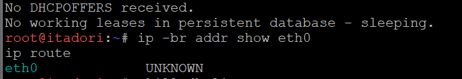

- Setelah relay dipulihkan, urutan `DHCPDISCOVER`, `DHCPOFFER`, `DHCPREQUEST`, `DHCPACK` berjalan lengkap dan client kembali mendapat `192.242.2.10` (Pool 1) dengan `default via 192.242.2.1`, sama seperti sebelum gangguan.
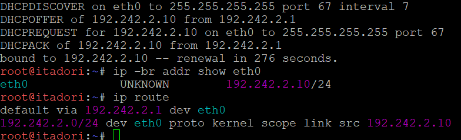

Menjalankan tcpdumb pada `jichi` dan `tengen`:
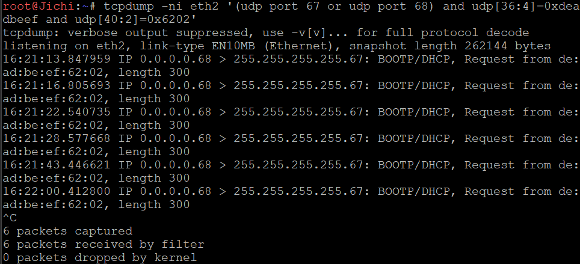
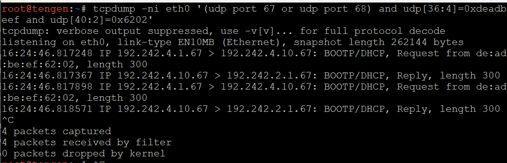

Kesimpulan: tanpa relay, DHCPDISCOVER broadcast dari Network 2 dan 3 berhenti di `jichi` dan tidak pernah mencapai `tengen`. Setelah relay dipulihkan, proses DHCP kembali normal dengan pool dan gateway yang benar.

## Soal 10.
Setelah gangguan Shibuya tertangani, pastikan pemulihan bertahan setelah restart. Aktifkan autostart DHCP Server pada tengen dan DHCP Relay pada jichi, lalu restart kedua node. Verifikasi status layanan, IP, gateway, lease, dan konektivitas client Network 2–3. Pastikan kebijakan Pool 1, Pool 2, short lease, long lease, dan fixed address tetap berlaku.

### Pengerjaan
Membuat script austostart untuk `jichi` dan `tengen`:
- isi script `soal10.sh` pada `jichi`:
``` bash
#!/bin/bash
for i in 1 2 3 4 5; do
    bash /root/jichi.sh > /root/autostart.log 2>&1
    pgrep -x dhcrelay >/dev/null && break
    sleep 15
done
```
- isi script `soal10.sh` pada `tengen`:
``` bash
#!/bin/bash
for i in 1 2 3 4 5; do
    bash /root/tengen.sh > /root/autostart.log 2>&1
    pgrep -x dhcpd>/dev/null && break
    sleep 15
done
```

### Testing
Setelah restart, periksa pada `jichi` dan `tengen`:
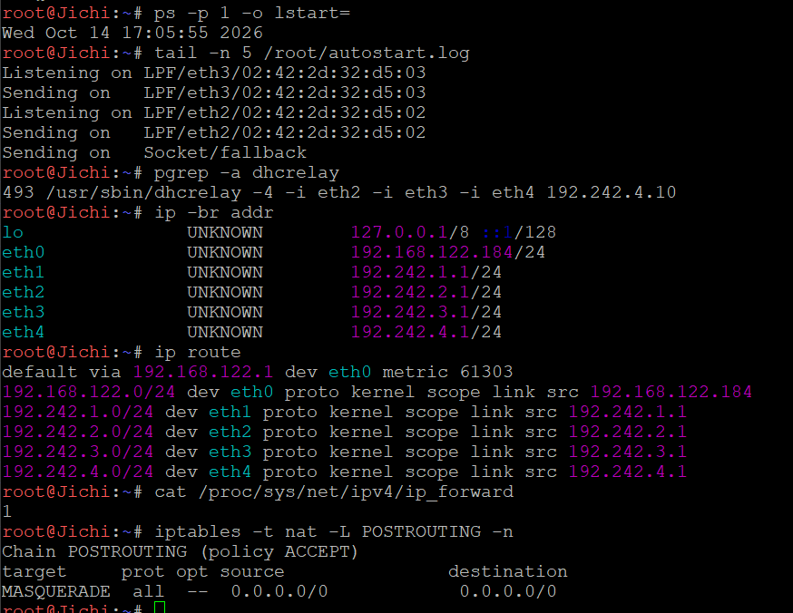
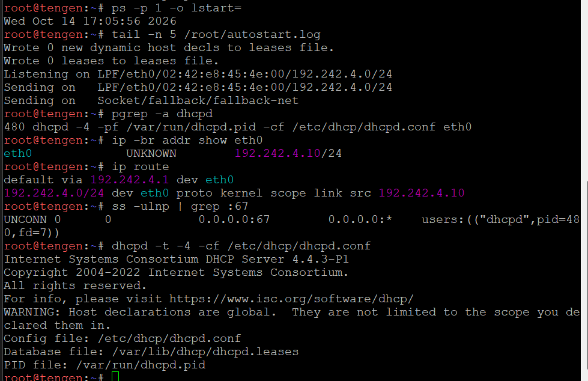

Pada setiap client Network 2 dan 3 (`itadori`, `fushiguro`, `zenin`, `okkotsu`, `ino`, `kusakabe`, `miwa`, `kugisaki`), minta lease baru dan uji konektivitas. Ping gateway disesuaikan dengan jaringan client (`192.242.2.1` untuk Network 2, `192.242.3.1` untuk Network 3):
```bash
pkill dhclient
ip addr flush dev eth0
rm -f /var/lib/dhcp/dhclient*.leases
dhclient -v eth0
ip -br addr show eth0
ip route
grep dhcp-lease-time /var/lib/dhcp/dhclient*.leases
ping -c 2 192.242.2.1    #(untuk Network 3: 192.242.3.1)
ping -c 2 8.8.8.8
```

Ringkasan hasil, menunjukkan kebijakan pool, lease, dan fixed address tetap berlaku setelah restart:

| Client | IP | Kebijakan | Gateway | Lease time pada client | Ping 8.8.8.8 |
| :--- | :--- | :--- | :--- | :--- | :--- |
| itadori | `192.242.2.10` | Pool 1 (`.2.10–.2.35`) | `192.242.2.1` | 589 | 0% loss |
| fushiguro | `192.242.2.11` | Pool 1 (`.2.10–.2.35`) | `192.242.2.1` | 491 | 0% loss |
| zenin | `192.242.2.70` | Pool 2 (`.2.70–.2.95`) | `192.242.2.1` | 501 | 0% loss |
| okkotsu | `192.242.2.71` | Pool 2 (`.2.70–.2.95`) | `192.242.2.1` | 510 | 0% loss |
| ino | `192.242.3.10` | Short lease (`.3.10–.3.89`) | `192.242.3.1` | 1760 | 0% loss |
| kusakabe | `192.242.3.11` | Short lease (`.3.10–.3.89`) | `192.242.3.1` | 1766 | 0% loss |
| miwa | `192.242.3.100` | Long lease (`.3.100–.3.199`) | `192.242.3.1` | 43181 | 0% loss |
| kugisaki | `192.242.3.99` | Fixed address | `192.242.3.1` | 600 | 0% loss |